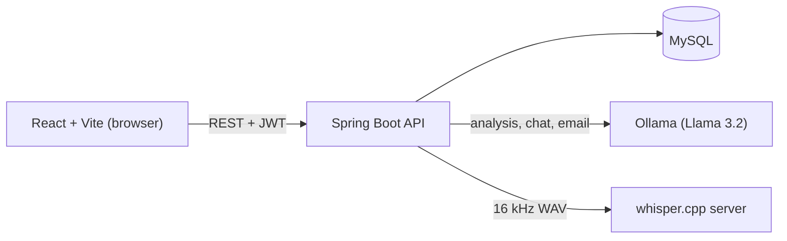

# DevMeetScribe AI

**Every Meeting. Every Insight. One Intelligent Assistant.**

DevMeetScribe AI turns meeting transcripts and recordings into a summary, decisions and action items. You can then ask the meeting questions, draft a follow-up email, and export a report. The AI runs locally with Ollama and Whisper, so your meetings stay on your own computer.

    

## Features

- **Accounts and privacy:** sign up and log in with JWT. Every meeting, task and chat belongs to one user, and the backend checks ownership on every query.
- **Add a meeting three ways:** paste a transcript, upload an audio file, or record from the microphone. Audio is transcribed locally with Whisper, and you can edit the text before saving.
- **AI analysis:** a short summary, the decisions that were made, and action items. Owners and deadlines stay empty unless the transcript names them, and low-confidence tasks get a **Verify** badge.
- **Editable tasks:** change titles, owners and deadlines, tick tasks off, and see all open tasks across meetings on one page.
- **Chat with your meeting:** ask questions and get answers with the exact transcript lines they came from. The quoted lines are copied from the stored transcript, never written by the model.
- **Follow-up email:** a draft in a professional, friendly or brief tone. Edit it, copy it, or open it in Gmail or Outlook.
- **Report export:** copy the notes as text, or print them to PDF.
- **Landing page:** an animated hero slider, feature overview and FAQ, shown before sign-in.

## Architecture



The browser converts any recording to 16 kHz mono WAV before upload, so no ffmpeg is needed.

## Tech stack

| Layer | Technology |
|---|---|
| Backend | Java 17+, Spring Boot 3.3, Spring Data JPA (Hibernate), Spring Security, Bean Validation |
| Auth | JWT (jjwt), BCrypt password hashing |
| Database | MySQL 8 |
| AI | Ollama with Llama 3.2 (summaries, tasks, chat, email), whisper.cpp (speech to text) |
| Frontend | React 19, Vite, Tailwind CSS 4, lucide-react |
| API docs and testing | Swagger UI (springdoc), Postman collection, JUnit 5 |

## Project structure

```
devmeetscribe-ai/
├── backend/    Spring Boot API (controller, service, repository, entity, dto, security, llm)
├── frontend/   React app (pages, components, lib, data)
└── docs/       Setup guides (audio-setup.md, auth-setup.md)
```

## Getting started

### Prerequisites

- JDK 17 or newer, and Maven (or Spring Tool Suite / IntelliJ)
- Node.js 22 (or 20.19+)
- MySQL 8
- [Ollama](https://ollama.com)
- Optional, for audio: the Whisper server (see [docs/audio-setup.md](docs/audio-setup.md))

### 1. Clone

```bash
git clone https://github.com/hariantarkar/devmeetscribe-ai.git
cd devmeetscribe-ai
```

### 2. Pull the AI model

```bash
ollama pull llama3.2
```

### 3. Configure and run the backend

The defaults are in `backend/src/main/resources/application.yml`. Override them with environment variables:

| Variable | Purpose | Default |
|---|---|---|
| `DB_URL` | MySQL JDBC URL | `jdbc:mysql://localhost:3306/meetscribe?...` |
| `DB_USER` / `DB_PASSWORD` | MySQL login | set these for your machine |
| `APP_JWT_SECRET` | Token signing secret (32+ characters) | random at startup, so logins reset on restart |
| `OLLAMA_BASE_URL` / `OLLAMA_MODEL` | Ollama address and model | `http://localhost:11434` / `llama3.2` |
| `WHISPER_BASE_URL` | Whisper server address | `http://localhost:8081` |

```bash
cd backend
mvn spring-boot:run
```

The API runs on `http://localhost:8080`. Tables are created automatically on first start. Swagger UI is at `http://localhost:8080/swagger-ui.html`.

### 4. Run the frontend

```bash
cd frontend
npm install
npm run dev
```

Open `http://localhost:5173`, create an account, and add your first meeting.

### 5. Optional: audio transcription

Follow [docs/audio-setup.md](docs/audio-setup.md) to start the local Whisper server on port 8081. Text transcripts work without it.

## API overview

All endpoints except register, login and health need `Authorization: Bearer <token>`. A Postman collection is in `backend/postman/`.

| Method | Endpoint | Description |
|---|---|---|
| POST | `/api/auth/register`, `/api/auth/login` | Create an account or sign in |
| GET | `/api/auth/me` | Current user |
| GET | `/api/health` | Database, Ollama and Whisper status (public) |
| POST / GET | `/api/meetings` | Create a meeting / list my meetings |
| GET / DELETE | `/api/meetings/{id}` | Meeting with summary, decisions and tasks |
| POST | `/api/meetings/{id}/analyze` | Run the AI analysis |
| GET / POST | `/api/meetings/{id}/tasks` | List or add tasks |
| GET | `/api/tasks?status=PENDING` | My tasks across meetings |
| PATCH / DELETE | `/api/tasks/{id}` | Update or delete a task |
| GET / POST / DELETE | `/api/meetings/{id}/chat` | Chat history, ask a question, clear |
| POST | `/api/meetings/{id}/email` | Draft a follow-up email |
| POST | `/api/transcribe` | Transcribe a WAV file (multipart) |

## Design notes

- **Checked answers.** For chat, the transcript is split into numbered lines. The model returns only the line numbers that support its answer, and the backend fills in the text from the stored transcript, so quotes cannot be invented.
- **Careful extraction.** The model is asked for strict JSON. The parser tolerates extra text, retries once, and leaves owners and deadlines empty unless they are stated. Low-confidence tasks are flagged for review.
- **No long transactions.** Calls to the AI model run outside database transactions, and results are saved in a short transaction afterwards.
- **Ownership everywhere.** Every query is limited to the signed-in user, so another account gets "not found" for your meeting IDs.

## Tests

```bash
cd backend
mvn test
```

Unit tests cover the transcript splitter, the AI response parsers, JWT handling and transcript clean-up.

## Limitations

- Transcripts are limited to 20,000 characters and recordings to about 25 minutes. Long-transcript chunking is not built yet.
- Quality depends on the small local model (Llama 3.2). It is best in English, and its output should be reviewed.
- The login token is stored in the browser's localStorage, which is fine for a learning project. A production app would use an httpOnly cookie.

## Roadmap

- Docker Compose for the whole stack, and deployment
- Chunking for long meetings
- Speaker identification
- Calendar integration

## Author

Built by **Hari Antarkar** ([@hariantarkar](https://github.com/hariantarkar)).
